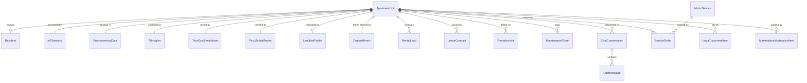
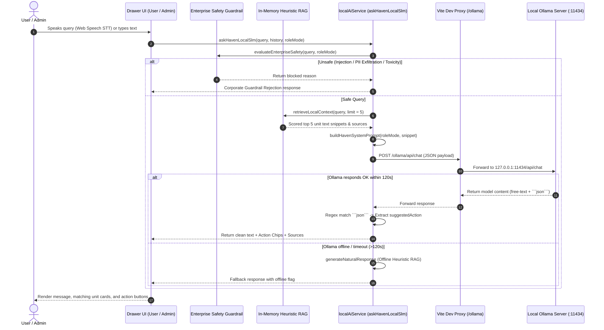

# HAVEN APARTMENT MANAGEMENT PLATFORM — AI & SYSTEM ARCHITECTURE AUDIT

**Target System:** Haven Apartment Rental & Operations Management Application (`HAVEN Sanctuary Living`)  
**Audited Codebase Path:** `d:\Workspace\Projects\AAA`  
**Audit Date:** 2026-10-21  
**Author:** Principal System & AI Architect  
**Classification:** Technical Architecture Audit & Agentic Modernization Blueprint  

---

## Executive Summary

The **Haven Apartment Management Platform** is a specialized Vietnamese PropTech single-page web application designed for property managers, landlords, and prospective tenants. The system addresses the fragmented management of apartment listings, tenant leads, lease contracts, utility billing, maintenance, and government fire safety compliance (QCVN 06:2022/BXD).

Architecturally, the application currently operates as a **client-side Single Page Application (SPA)** with **zero custom backend API servers** and **zero server-side persistent relational/NoSQL databases**. All application state is stored either in volatile client memory (seeded by 1,700 pre-generated mock records) or in browser `localStorage` delta keys. AI capabilities are delivered primarily via a **local Edge Small Language Model (SLM)** through an Ollama daemon (`qwen2.5:7b` / fine-tuned `qwen2.5-0.5B` GGUF), backed by a local in-memory heuristic RAG engine, in-browser Canvas computer vision heuristics, and cloud LLM fallbacks (Google Gemini and Groq Cloud).

While the user interface and visual design system are exceptionally polished, the underlying data layer, API surface, and AI execution pipelines exhibit critical architectural bottlenecks that prevent production scalability, multi-device synchronization, and autonomous agentic task execution. This document presents an exhaustive, component-by-component technical audit of the codebase to serve as the ground truth for system modernization.

---

## 1. Tech Stack, Runtime & Dependencies

### 1.1 Core Runtime & Frameworks

| Layer | Technology | Exact Version in Codebase | Source File & Reference |
| :--- | :--- | :--- | :--- |
| **Frontend Framework** | React | `19.2.8` | [`package.json:L19`](file:///d:/Workspace/Projects/AAA/package.json#L19) |
| **DOM Renderer** | React DOM | `19.2.8` | [`package.json:L20`](file:///d:/Workspace/Projects/AAA/package.json#L20) |
| **Language** | TypeScript | `~6.0.2` | [`package.json:L31`](file:///d:/Workspace/Projects/AAA/package.json#L31), [`tsconfig.json`](file:///d:/Workspace/Projects/AAA/tsconfig.json) |
| **Bundler & Dev Server** | Vite | `8.2.0` | [`package.json:L32`](file:///d:/Workspace/Projects/AAA/package.json#L32), [`vite.config.ts`](file:///d:/Workspace/Projects/AAA/vite.config.ts) |
| **CSS Engine** | Tailwind CSS v4 | `4.3.3` (`@tailwindcss/vite: 4.3.3`) | [`package.json:L16,L22`](file:///d:/Workspace/Projects/AAA/package.json#L16) |
| **Backend Framework** | **NONE** (Client SPA) | N/A | No Node.js / Express / NestJS / FastAPI / Django / ASP.NET runtime |
| **Database Engine** | **NONE** (Browser In-Memory + `localStorage`) | N/A | Backed by `MOCK_UNITS` (1,700 records) and browser Web Storage |
| **ORM / Query Builder** | **NONE** | N/A | Hand-coded static class methods in [`ApartmentStore`](file:///d:/Workspace/Projects/AAA/src/data/apartmentStore.ts#L901) |
| **Linter** | Oxlint | `1.75.0` | [`package.json:L30`](file:///d:/Workspace/Projects/AAA/package.json#L30), [`.oxlintrc.json`](file:///d:/Workspace/Projects/AAA/.oxlintrc.json) |
| **Desktop Launcher** | C# .NET CLR Console | .NET Framework / Core | [`launcher/Program.cs`](file:///d:/Workspace/Projects/AAA/launcher/Program.cs#L1-L131) |

### 1.2 Full Dependency Manifest (`package.json`)

#### Production Dependencies (`dependencies`)
* `@react-spring/three` (`^10.1.2`): Spring-physics animation bridge for React Three Fiber.
* `@react-three/drei` (`^10.7.8`): Helper abstractions for Three.js in React.
* `@react-three/fiber` (`^9.7.0`): Declarative Three.js WebGL renderer for React.
* `@tailwindcss/vite` (`^4.3.3`): Vite plugin for Tailwind CSS v4 zero-configuration engine.
* `framer-motion` (`^13.1.0`): Micro-interaction and layout transition engine (drawers, modals, page reveals).
* `lucide-react` (`^1.31.0`): Iconography suite across User and Admin interfaces.
* `react` (`^19.2.8`): Core UI library.
* `react-dom` (`^19.2.8`): DOM renderer for React.
* `shadergradient` (`^1.3.5`): WebGL animated gradient canvas background (`ShaderBackground.tsx`).
* `tailwindcss` (`^4.3.3`): Utility-first styling framework.
* `three` (`^0.185.1`): Core 3D/WebGL rendering library.

#### Development Dependencies (`devDependencies`)
* `@types/node` (`^24.13.3`): Type definitions for Node.js APIs (used in launchers and Vite config).
* `@types/react` (`^19.2.17`): Type definitions for React 19.
* `@types/react-dom` (`^19.2.3`): Type definitions for React DOM.
* `@vitejs/plugin-react` (`^6.0.4`): Official Babel/SWC Fast Refresh plugin for Vite.
* `oxlint` (`^1.75.0`): Rust-based ultra-fast JavaScript/TypeScript linter.
* `typescript` (`~6.0.2`): TypeScript language compiler.
* `vite` (`^8.2.0`): Next-generation frontend tooling.

### 1.3 AI, OCR, Vision & Specialized Tooling

* **Local LLM Daemon:** Ollama Desktop (Windows executable at `%LOCALAPPDATA%\Programs\Ollama\ollama.exe` or PATH `ollama.exe`). Listens on port `11434`.
* **Vite Reverse Proxy:** Custom proxy configured in [`vite.config.ts:L17-23`](file:///d:/Workspace/Projects/AAA/vite.config.ts#L17-L23) forwarding `/ollama/*` to `http://127.0.0.1:11434/*` to eliminate browser CORS restrictions.
* **Speech-to-Text (STT):** Native browser Web Speech API (`window.SpeechRecognition` / `window.webkitSpeechRecognition`) wrapped in [`VoiceRecognitionService.ts`](file:///d:/Workspace/Projects/AAA/src/services/voiceRecognitionService.ts).
* **Vision & Aesthetics Heuristics:**
  * In-Browser HTML5 Canvas pixel tensor analyzer in [`VisualVibeModal.tsx:L134-210`](file:///d:/Workspace/Projects/AAA/src/components/VisualVibeModal.tsx#L134-L210) (extracts color temperature, wood/stone/marble ratios, and maps to archetype centers).
  * Precomputed 512-dimensional CLIP embeddings (`openai/clip-vit-base-patch32`) stored in [`src/data/visualEmbeddings.ts`](file:///d:/Workspace/Projects/AAA/src/data/visualEmbeddings.ts) (712 normalized vectors).
* **Cloud LLM APIs (Client Direct Fetch):**
  * Google Gemini API (`https://generativelanguage.googleapis.com/v1beta/models/{model}:generateContent` and `text-embedding-004`).
  * Groq Cloud API (`https://api.groq.com/openai/v1/chat/completions` using `llama-3.3-70b-versatile`).
* **Model Fine-Tuning & Quantization Pipeline:**
  * Jupyter Notebook [`scripts/train_haven_local_qwen.ipynb`](file:///d:/Workspace/Projects/AAA/scripts/train_haven_local_qwen.ipynb): Python with Unsloth (`unsloth[colab-new]`), PyTorch, Hugging Face `transformers`, `trl` (`SFTTrainer`), `peft` (QLoRA: `r=16, alpha=16`), `bitsandbytes` (4-bit), and `datasets`.
  * Exports base model `unsloth/Qwen2.5-0.5B-Instruct-bnb-4bit` to `haven-qwen-0.5b-q4_k_m.gguf` (~350MB).

---

## 2. Complete Directory & File Architecture

```
d:\Workspace\Projects\AAA\
├── .env.example                               # Environment variable templates (Gemini, Groq, Supabase keys)
├── .oxlintrc.json                             # Oxlint rule configuration for React hooks & component exports
├── index.html                                 # HTML5 entry point with Google Fonts (Plus Jakarta Sans, Inter)
├── package.json                               # NPM packages, build scripts, engine definitions
├── tsconfig.json                              # TypeScript root project references
├── tsconfig.app.json                          # TypeScript configuration for src/ application code
├── tsconfig.node.json                         # TypeScript configuration for Vite & build scripts
├── vite.config.ts                             # Vite configuration with Tailwind CSS plugin & /ollama proxy
├── launcher/                                  # Desktop application orchestration
│   ├── Program.cs                             # C# .NET console app: starts Ollama, Node server, opens browser
│   ├── serve.js                               # Node.js dev server runner with Ollama health-check & auto-spawn
│   └── haven.ico                              # Windows desktop icon asset
├── data/                                      # Static datasets, visual embeddings & training files
│   ├── 01_haven_qa_dataset.jsonl              # 2,507 samples of domain Q&A pairs for Qwen fine-tuning
│   ├── 02_haven_image_manifest_818.json       # 818 architectural photos manifest tagged with styles & cities
│   ├── haven_visual_embeddings_clip.json      # 712 unique 512-D normalized CLIP feature vectors
│   └── mock_units_1700.json                   # 1,700 apartment records in JSON format (~8.0 MB)
├── scripts/                                   # Automation, benchmarking & AI training scripts
│   ├── Modelfile                              # Ollama custom model definition pointing to GGUF artifact
│   ├── setup_ollama_haven.bat                 # Windows batch script executing `ollama create haven-ai`
│   ├── benchmark_100_questions.cjs            # 100-question automated benchmark runner for Ollama Qwen
│   ├── benchmark_100_results.json             # Benchmark raw telemetry (latency, token rates, tool accuracy)
│   ├── train_haven_local_qwen.ipynb           # Colab notebook: QLoRA fine-tuning Qwen 0.5B & GGUF export
│   ├── 02_train_haven_visual_clip.ipynb       # Colab notebook: CLIP ViT-B/32 embedding extraction
│   ├── build_1700_units_dataset.py            # Synthetic dataset generator for 1,700 Vietnamese apartments
│   ├── vietnam_63_provinces.py                # Normalized geographic catalog for 63 Vietnamese provinces
│   ├── check_images.js / check_images.py      # HTTP image URL availability and 404 validator scripts
│   └── test_all_818_urls.py                   # Parallel HTTP head-check probe for image manifests
├── public/                                    # Static assets served at root
│   ├── images/                                # Apartment unit photography assets
│   └── property-hero.png                      # Hero photography fallback
└── src/                                       # Application source tree
    ├── main.tsx                               # React 19 root bootstrap & DOM mounting
    ├── App.tsx                                # Central SPA state controller, hash router, and modal host
    ├── index.css                              # Design tokens, Tailwind v4 imports, Wise theme classes
    ├── App.css                                # Legacy helper classes and animation keyframes
    ├── types/
    │   └── apartment.ts                       # Complete domain TypeScript interfaces, types, and enums
    ├── data/
    │   ├── apartmentStore.ts                  # Static client-side database class (CRUD, calculation, localStorage)
    │   ├── mockData.ts                        # 1,700 generated apartment unit objects exported as MOCK_UNITS
    │   ├── visualEmbeddings.ts                # 512-D precomputed CLIP vector dictionaries & cosine similarity
    │   ├── matterportTours.ts                 # 50+ 3D Matterport virtual digital twin tour references
    │   └── countries.ts                       # International phone country codes for tenant onboarding
    ├── services/
    │   ├── localAiService.ts                  # Pure local Ollama SLM interface (Qwen 7B) & heuristic RAG
    │   ├── geminiRagService.ts                # Cloud LLM interface (Gemini/Groq), safety guardrail wrapper, RAG
    │   ├── aiAdvisorService.ts                # Natural language parser, criteria classification & match scoring
    │   ├── enterpriseSafetyGuardrail.ts       # 3-layer safety guardrail (injection, toxicity, PII, role ACL)
    │   └── voiceRecognitionService.ts         # Web Speech API wrapper for continuous voice input
    ├── hooks/
    │   ├── useScrollReveal.ts                 # IntersectionObserver hook for scroll-triggered CSS reveals
    │   └── useFirstLoadReveal.ts              # First-paint animation trigger hook
    ├── styles/
    │   ├── tokens.css                         # OKLCH color palette design tokens, typography, radii
    │   ├── wiseTheme.css                      # Wise-inspired design primitives (.wise-kpi-card, .wise-pill-tab)
    │   ├── utilities.css                      # Custom Tailwind utility extensions
    │   ├── beamEffects.css                    # Ambient lighting and animated border effects
    │   └── borderGlow.css                     # Radial gradient hover glow effects
    ├── devtools/
    │   └── preview/
    │       └── DevPreviewLauncher.tsx         # In-browser developer preview launcher
    └── components/                            # UI Components & View Screens
        ├── Topbar.tsx                         # Fixed global navigation header, quick search, role toggle, profile
        ├── Sidebar.tsx                        # Fixed collapsible navigation sidebar (User vs Admin tabs)
        ├── Footer.tsx                         # Global landing and directory footer
        ├── AuthModal.tsx                      # Login/register modal, mock quick accounts, Supabase Auth test
        ├── ChatModal.tsx                      # In-app messaging modal between tenant and landlord
        ├── QuickActionModal.tsx               # Global shortcut command launcher (Ctrl+K / Cmd+K style)
        ├── Toast.tsx                          # Ephemeral status toast notifications container
        ├── ShaderBackground.tsx               # 60FPS WebGL dynamic animated mesh background
        ├── UserHomeView.tsx                   # Consumer landing page, hero highlights, lifestyle entries
        ├── UserSearchView.tsx                 # 1,700-unit search directory with multi-facet filters & infinite scroll
        ├── UserUnitDetailView.tsx             # Unit detail screen (True Cost, PCCC report, landlord profile)
        ├── UserCompareView.tsx                # Side-by-side unit comparison screen with 5-axis Radar chart
        ├── UserAiAdvisorDrawer.tsx            # Floating resizable AI assistant drawer for consumer users
        ├── MoveInChecklistView.tsx            # 15-item digital handover inspection checklist with meter inputs
        ├── NeighborhoodGuideView.tsx          # District urban guides, flood risks, infrastructure profiles
        ├── DocumentVaultView.tsx              # SHA-256 encrypted legal document repository
        ├── ServicesMarketplaceView.tsx        # Value-Added Services (cleaning, moving, smart home locks)
        ├── SubscriptionsView.tsx              # SaaS subscription plans (Landlord) & Prime Club (Tenant)
        ├── DashboardView.tsx                  # Admin executive operations dashboard (KPIs, overdue, occupancy)
        ├── UnitsView.tsx                      # Admin inventory table (CRUD, status flipping, filtering)
        ├── LeadsView.tsx                      # Admin rental inquiry lead pipeline & conversion triggers
        ├── AdminInboxView.tsx                 # Admin two-pane Shopee-style conversation center
        ├── ContractsView.tsx                  # Admin lease contract ledger & e-sign activation modal
        ├── PaymentsView.tsx                   # Admin monthly invoice billing ledger & payment confirmation
        ├── MarketplaceHealthView.tsx          # Admin governance dashboard, auto-check score & moderation queue
        ├── AiCopilotDrawer.tsx                # Admin AI Copilot drawer for financial and operations telemetry
        ├── SmartListingCreatorModal.tsx       # AI listing wizard with automated description and pricing
        ├── VisualVibeModal.tsx                # Visual vibe search modal using HTML5 Canvas & CLIP vectors
        ├── LifestyleMatchmakerModal.tsx       # Interactive 4-question lifestyle quiz matching apartments
        ├── CommuteSimulatorModal.tsx          # Peak vs normal commute time calculator for Vietnamese cities
        ├── DepositEscrowModal.tsx             # BIDV escrow deposit protection simulation walkthrough
        ├── LandlordProfileModal.tsx           # Landlord verification badges, trust score, and active listings
        ├── SignContractModal.tsx              # Digital e-signature canvas pad for lease contracts
        ├── GeminiKeyModal.tsx                 # In-browser Gemini & Groq API key configuration dialog
        ├── common/
        │   ├── SmartImage.tsx                 # Image loader with skeleton placeholder and error fallback
        │   └── HavenCursor.tsx                # Custom interactive cursor particle effects
        ├── home/
        │   ├── HeroSection.tsx                # Video background hero section with quick filter bar
        │   ├── FeatureStrip.tsx               # Brand guarantees strip (Escrow, True Cost, PCCC, Verified)
        │   └── FeaturedProperties.tsx         # Curated carousel of featured luxury properties
        ├── layout/
        │   └── MobileNav.tsx                  # Responsive bottom navigation bar for mobile viewports
        └── ui/
            ├── Button.tsx                     # Core design system button primitive
            ├── Card.tsx                       # Core card container primitive
            ├── Badge.tsx                      # Pill badge tag primitive
            ├── BorderGlowCard.tsx             # Interactive cursor-tracking glowing card
            ├── ShaderCard.tsx                 # WebGL mesh gradient card
            └── GlassCursor.tsx                # Glassmorphic cursor trail component
```

---

## 3. Complete Database Schema, Entities & Relationships

The application lacks an external database engine. All entities are formally defined as TypeScript interfaces in [`src/types/apartment.ts`](file:///d:/Workspace/Projects/AAA/src/types/apartment.ts) and instantiated in [`src/data/apartmentStore.ts`](file:///d:/Workspace/Projects/AAA/src/data/apartmentStore.ts).



### 3.1 Entity Specifications & Schemas

#### 1. `ApartmentUnit` (Core Inventory Model)
Defined in [`src/types/apartment.ts:L92-137`](file:///d:/Workspace/Projects/AAA/src/types/apartment.ts#L92-L137). Central aggregate root of the system.

```typescript
export interface ApartmentUnit {
  id: string;                                          // PK (e.g. "HN-TH-2401", "SG-D1-1601")
  name?: string;                                       // Full listing name (e.g. "Penthouse Hồ Tây Panorama")
  floor: number;                                       // Floor index (1 to 45)
  unitNumber: string;                                  // Room number string (e.g. "2401", "1601")
  type: UnitType;                                      // Enum: 'Penthouse' | 'Sky Villa' | 'Executive Suite' | 'Deluxe Apartment' | 'Studio' | 'Duplex' | 'Villa'
  sqm: number;                                         // Usable floor area in square meters (e.g. 85, 240)
  bedrooms: number;                                    // Bedroom count (1 to 5)
  bathrooms: number;                                   // Bathroom count (1 to 5)
  status: UnitStatus;                                  // Enum: 'vacant' | 'occupied' | 'reserved' | 'pending_handover' | 'maintenance'
  monthlyRentUSD: number;                              // Rent in USD (deprecated reference)
  monthlyRentVND: number;                              // Base monthly rent in Vietnamese Dong (e.g. 18500000)
  city: string;                                        // Province/City (e.g. "Hà Nội", "TP. Hồ Chí Minh", "Thái Nguyên")
  district: string;                                    // District (e.g. "Tây Hồ", "Quận 1", "Cầu Giấy")
  address?: string;                                    // Street address (e.g. "68 Quảng An, Phường Quảng An")
  images: string[];                                    // Array of 4 image URLs (verified Unsplash or internal CDN)
  hasCarParking: boolean;                              // True if building has designated underground car parking
  hasMotorbikeParking: boolean;                        // True if building has motorbike parking
  hasElevator: boolean;                                // True if high-speed elevator is installed
  hasBackupPower: boolean;                             // True if 100% industrial diesel backup generator exists
  floodingRisk: 'Low' | 'Moderate' | 'High';           // Monsoon rain flooding vulnerability classification
  noiseLevel: 'Quiet' | 'Moderate' | 'Busy';           // Acoustic environment rating
  trafficDensity: 'Low' | 'Moderate' | 'Heavy';        // Surrounding street peak traffic density
  petFriendly: boolean;                                // True if pet animals (dogs/cats) are permitted
  furnished: boolean;                                  // True if full interior furniture package is included
  balcony: boolean;                                    // True if private outdoor balcony exists
  airConditioning: boolean;                            // True if HVAC / split AC is pre-installed
  washingMachine: boolean;                             // True if in-unit washer/dryer exists
  kitchen: boolean;                                    // True if enclosed or modular kitchen is built-in
  wifi: boolean;                                       // True if high-speed fiber internet is active
  rating: number;                                      // Rating score from 1.0 to 5.0 (e.g. 4.9)
  reviewCount: number;                                 // Total verified resident reviews count
  viewType: string;                                    // Free-text view description (e.g. "View Hồ Tây trực diện")
  orientation?: string;                                // Balcony compass orientation (e.g. "Đông Nam", "Nam")
  isVerifiedPlus?: boolean;                            // VIP verified badge boost flag
  verificationLevel?: VerificationLevel;               // Enum: 'unverified' | 'id_verified' | 'full_ownership_verified'
  coordinates?: { lat: number; lng: number };          // Geolocation coordinate pair
  
  // Embedded Complex Objects
  aiInsights: AIInsights;                              // AI evaluation strengths and trade-offs
  environmentalData: EnvironmentalData;                // Climate and municipal notes
  resident?: Resident;                                 // Current tenant record (if occupied)
  sensors: IoTSensors;                                 // IoT telemetry stream state
  trueCost?: TrueCostBreakdown;                        // Complete itemized monthly cost calculation
  pcccReport?: PcccSafetyReport;                       // Fire safety compliance certification
  landlord?: LandlordProfile;                          // Host / owner profile information
  depositTerms?: DepositTerms;                         // Security deposit terms and refund rules
}
```

#### 2. `TrueCostBreakdown` (Transparent Expense Schema)
Defined in [`src/types/apartment.ts:L42-54`](file:///d:/Workspace/Projects/AAA/src/types/apartment.ts#L42-L54).

```typescript
export interface TrueCostBreakdown {
  baseRentVND: number;                                 // Raw monthly lease rate (e.g. 15,000,000 VND)
  estimatedElectricityVND: number;                     // Estimated EVN tariff electricity (~3,500 VND/kWh)
  waterFeeVND: number;                                 // Domestic clean water (~70,000 VND/bedroom)
  internetFeeVND: number;                              // High-speed fiber internet (~250,000 VND fixed)
  managementFeeVND: number;                            // Building management fee (sqm * 16,000 to 22,000 VND)
  parkingFeeVND: number;                               // Parking fee (1,200,000 VND car; 120,000 VND bike)
  totalMonthlyEstimatedVND: number;                    // Sum of all monthly obligations
  depositMonths: number;                               // Escrow deposit multiplier (1 or 2 months)
  depositVND: number;                                  // Total security deposit amount (baseRent * depositMonths)
  moveInTotalRequiredVND: number;                      // Total capital required on move-in day (Deposit + Month 1)
  electricityRatePerKwh?: number;                      // Electricity rate per kWh (EVN state rate: 3,500 VND)
}
```

#### 3. `PcccSafetyReport` (Fire Safety Regulation Compliance Schema)
Defined in [`src/types/apartment.ts:L56-66`](file:///d:/Workspace/Projects/AAA/src/types/apartment.ts#L56-L66). Implements National Building Code QCVN 06:2022/BXD.

```typescript
export interface PcccSafetyReport {
  hasFireEscapes: boolean;                             // True if independent emergency stairs exist
  fireEscapeCount: number;                             // Number of positive-pressure smoke-proof staircases (2 or 3)
  hasAutomaticSprinklers: boolean;                     // True if automatic high-pressure water sprinkler heads exist
  hasSmokeDetectors: boolean;                          // True if connected optical smoke sensors exist
  hasFireExtinguishers: boolean;                       // True if ABC powder extinguishers are certified in corridor
  inspectionCertificateStatus: 'certified' | 'pending_renewal' | 'unverified'; // Official municipal fire police status
  lastInspectionDate?: string;                         // ISO date of last official inspection (e.g. "2025-11-15")
  emergencyExitWidthMeters?: number;                   // Corridor escape door width (standard: >= 1.4m)
  disclaimer: string;                                  // Legal compliance disclaimer string
}
```

#### 4. `RentalLead` (CRM Pipeline Model)
Defined in [`src/types/apartment.ts:L141-154`](file:///d:/Workspace/Projects/AAA/src/types/apartment.ts#L141-L154).

```typescript
export type LeadStatus = 'new' | 'contacted' | 'viewing_scheduled' | 'approved' | 'rejected' | 'converted';

export interface RentalLead {
  id: string;                                          // PK (e.g. "LEAD-2026-001")
  customerName: string;                                // Prospective tenant full name
  phone: string;                                       // Contact telephone number
  email?: string;                                      // Contact email
  unitId: string;                                      // FK -> ApartmentUnit.id
  unitName: string;                                    // Denormalized apartment name snapshot
  unitPriceVND: number;                                // Monthly rent snapshot at lead time
  desiredMoveInDate: string;                           // Requested lease start date (ISO date string)
  viewingDate?: string;                                // Scheduled physical inspection appointment timestamp
  notes?: string;                                      // Customer preferences, pet requests, EV charger notes
  createdAt: string;                                   // Creation timestamp (YYYY-MM-DD HH:mm)
  status: LeadStatus;                                  // State machine current status
}
```

#### 5. `LeaseContract` (Digital E-Signed Lease Model)
Defined in [`src/types/apartment.ts:L158-175`](file:///d:/Workspace/Projects/AAA/src/types/apartment.ts#L158-L175).

```typescript
export type ContractStatus = 'active' | 'expiring_soon' | 'pending_signature' | 'terminated';

export interface LeaseContract {
  id: string;                                          // PK (e.g. "CTR-2026-088")
  contractNumber: string;                              // Business code (e.g. "HDT-2026/SG-D1-1601")
  unitId: string;                                      // FK -> ApartmentUnit.id
  unitName: string;                                    // Denormalized apartment title
  tenantName: string;                                  // Lessee full legal name
  tenantPhone: string;                                 // Lessee telephone
  tenantIdCard: string;                                // Citizen identity card / Passport number (CCCD)
  startDate: string;                                   // Lease initiation date (ISO date string)
  endDate: string;                                     // Lease termination date (ISO date string)
  monthlyRentVND: number;                              // Contracted monthly rental fee
  depositVND: number;                                  // Escrow deposit held
  paymentCycleMonths: number;                          // Billing cycle in months (1, 3, 6, 12)
  status: ContractStatus;                              // Contract lifecycle state
  termsSummary: string;                                // Legal clauses summary string
  createdAt: string;                                   // Contract generation date
  platformCommissionVND?: number;                      // Platform broker commission (50% to 100% first month)
}
```

#### 6. `RentalInvoice` (Billing Ledger & Rent Collection Model)
Defined in [`src/types/apartment.ts:L179-194`](file:///d:/Workspace/Projects/AAA/src/types/apartment.ts#L179-L194).

```typescript
export type InvoiceStatus = 'paid' | 'pending' | 'overdue';

export interface RentalInvoice {
  id: string;                                          // PK (e.g. "INV-2026-0801")
  invoiceCode: string;                                 // Ledger code (e.g. "HD-0826-001")
  unitId: string;                                      // FK -> ApartmentUnit.id
  unitName: string;                                    // Apartment name
  tenantName: string;                                  // Tenant name
  monthYear: string;                                   // Billing period string (e.g. "Tháng 08/2026")
  rentAmountVND: number;                               // Base rent amount
  serviceFeeVND: number;                               // Maintenance & management fee
  electricityWaterVND: number;                         // Metered utilities amount
  totalAmountVND: number;                              // Total receivable (rent + service + utilities)
  dueDate: string;                                     // Payment deadline date (YYYY-MM-DD)
  paidDate?: string;                                   // Settlement timestamp when marked paid
  status: InvoiceStatus;                               // Payment collection status
  platformTakeRateVND?: number;                        // 5% SaaS management take-rate retained by platform
}
```

#### 7. `ChatConversation` & `ChatMessage` (Shopee-Style Messaging Schema)
Defined in [`src/types/apartment.ts:L225-246`](file:///d:/Workspace/Projects/AAA/src/types/apartment.ts#L225-L246).

```typescript
export interface ChatMessage {
  id: string;                                          // PK (e.g. "msg-1729000000-abcd")
  conversationId: string;                              // FK -> ChatConversation.id
  sender: 'user' | 'landlord' | 'bot';                 // Sender category
  senderName: string;                                  // Display name
  text: string;                                        // Message body text
  timestamp: string;                                   // Formatted time string (HH:mm)
  isQuickReply?: boolean;                              // True if bot automated prompt chip
}

export interface ChatConversation {
  id: string;                                          // PK (e.g. "conv-HN-TH-2401-9912")
  unitId: string;                                      // FK -> ApartmentUnit.id
  unitName: string;                                    // Apartment name
  customerName: string;                                // Tenant / customer name
  customerPhone: string;                               // Tenant telephone
  lastMessage: string;                                 // Preview snippet of latest message
  lastTimestamp: string;                               // Relative time string (e.g. "Vừa xong", "14:20")
  unreadCount: number;                                 // Unread messages counter
  status: 'active' | 'archived';                       // Channel status
  messages: ChatMessage[];                             // Embedded chronological message collection
}
```

#### 8. Supporting Auxiliary Schemas
* **`IoTSensors`** ([`apartment.ts:L19-26`](file:///d:/Workspace/Projects/AAA/src/types/apartment.ts#L19-L26)): `smartLockBattery` (number: 0-100), `hvacStatus` ('Optimal'|'Cooling'|'Heating'|'Standby'), `targetTempC` (number), `energyConsumptionKwh` (number), `waterUsageLiters` (number), `securityAlarmDisarmed` (boolean).
* **`EnvironmentalData`** ([`apartment.ts:L28-33`](file:///d:/Workspace/Projects/AAA/src/types/apartment.ts#L28-L33)): `weatherNotes`, `floodNotes`, `powerNotes`, `trafficNotes` (strings).
* **`LandlordProfile`** ([`apartment.ts:L68-82`](file:///d:/Workspace/Projects/AAA/src/types/apartment.ts#L68-L82)): `id`, `name`, `avatar`, `phone`, `verificationLevel`, `trustScore` (3.0 to 5.0), `reviewCount`, `responseRatePercent`, `averageResponseMinutes`, `activeListingsCount`, `joinedDate`, `isSuperHost`, `badges` (string[]).
* **`DepositTerms`** ([`apartment.ts:L84-90`](file:///d:/Workspace/Projects/AAA/src/types/apartment.ts#L84-L90)): `months`, `amountVND`, `refundTimelineDays`, `deductionRules` (string[]), `depositProtectionActive` (boolean).
* **`MarketplaceModerationItem`** ([`apartment.ts:L341-358`](file:///d:/Workspace/Projects/AAA/src/types/apartment.ts#L341-L358)): `id`, `unitId` (FK), `unitName`, `landlordName`, `landlordPhone`, `submittedAt`, `status` ('pending'|'approved'|'flagged'|'rejected'), `flagReason`, `priceAnomalyPercent`, `duplicateScorePercent`, `autoCheckResult` (`photoAuthenticityScore`, `priceWithinRange`, `noSpamKeywords`, `pcccDocAttached`).
* **`LegalDocumentItem`** ([`apartment.ts:L328-339`](file:///d:/Workspace/Projects/AAA/src/types/apartment.ts#L328-L339)): `id`, `title`, `category` ('contract'|'deposit_escrow'|'pccc_cert'|'handover_report'|'ownership_doc'), `unitId` (FK), `unitName`, `fileSizeKb`, `uploadedAt`, `verified` (boolean), `hashSignature` (SHA-256 fingerprint), `downloadUrl`.
* **`ServiceOrder`** ([`apartment.ts:L274-285`](file:///d:/Workspace/Projects/AAA/src/types/apartment.ts#L274-L285)): `id`, `serviceId` (FK -> AddonService), `serviceTitle`, `customerName`, `customerPhone`, `unitId` (FK), `scheduledDate`, `priceVND`, `status` ('pending'|'confirmed'|'completed'|'cancelled'), `createdAt`.
* **`MaintenanceTicket`** ([`apartment.ts:L207-219`](file:///d:/Workspace/Projects/AAA/src/types/apartment.ts#L207-L219)): `id`, `unitId` (FK), `title`, `description`, `status` ('Open'|'In Progress'|'Resolved'), `priority` ('Low'|'Medium'|'High'|'Emergency'|'Urgent'), `category`, `residentName`, `assignedTechnician`.

---

## 4. Deep-Dive into Current AI/LLM Architecture

### 4.1 Inference Setup & Local Runtime

The local AI inference pipeline is designed to execute completely offline on consumer hardware with zero cloud dependencies.



#### Detailed Inference Parameters
Extracted verbatim from [`src/services/localAiService.ts:L360-375`](file:///d:/Workspace/Projects/AAA/src/services/localAiService.ts#L360-L375):
* **Endpoint URL:** `http://127.0.0.1:11434/api/chat` (via Vite proxy `/ollama/api/chat`).
* **HTTP Method:** `POST`
* **Model Selection Order:** `['qwen2.5:7b', 'qwen2.5-coder:7b', 'qwen:7b', 'haven-ai', 'qwen2.5:3b', 'qwen2.5:latest', 'qwen2.5', 'qwen']` (auto-detected via `GET /api/tags`).
* **Timeout:** `120,000 ms` (120 seconds AbortController).
* **Streaming:** `stream: false` (full synchronous buffered response).
* **Ollama Options:**
  ```json
  {
    "temperature": 0.35,
    "num_ctx": 4096,
    "num_predict": 2048,
    "threads": 8
  }
  ```

### 4.2 System Prompts & Templates (100% Verbatim Extraction)

#### 1. Ollama Modelfile System Prompt
File: [`scripts/Modelfile:L3-15`](file:///d:/Workspace/Projects/AAA/scripts/Modelfile#L3-L15)
```dockerfile
TEMPLATE """<|im_start|>system
{{ .System }}<|im_end|>
<|im_start|>user
{{ .Prompt }}<|im_end|>
<|im_start|>assistant
"""

PARAMETER stop "<|im_start|>"
PARAMETER stop "<|im_end|>"
PARAMETER temperature 0.7
PARAMETER top_p 0.9

SYSTEM """Bạn là HAVEN AI - Trợ lý Trí tuệ Nhân tạo Độc quyền của Nền tảng PropTech HAVEN (Sanctuary Living), chuyên tư vấn không gian sống, căn hộ cho thuê cao cấp, pháp lý và lối sống tại Việt Nam."""
```

#### 2. Local AI Admin System Prompt
File: [`src/services/localAiService.ts:L218-254`](file:///d:/Workspace/Projects/AAA/src/services/localAiService.ts#L218-L254)
```text
Bạn là HAVEN AI Copilot - Trợ lý Trí tuệ Vận hành & Quản trị Bất động sản cấp cao chạy cục bộ 100% (Local Qwen 7B SLM).
Định danh & Bản chất: Bạn là mô hình AI mã nguồn mở Qwen 7B chạy cục bộ trên máy tính qua Ollama Engine. Toàn bộ dữ liệu được bảo mật trên máy chủ nội bộ.
Nhiệm vụ: Hỗ trợ ban quản trị và chủ nhà giám sát 1,700 căn hộ, thu tiền thuê quá hạn, soạn hợp đồng điện tử E-Sign, tạo tin đăng căn hộ mới, cảm biến IoT và quy chuẩn an toàn PCCC QCVN 06.
Phong cách trả lời: Chuyên nghiệp, súc tích, đưa ra con số chính xác và khuyến nghị hành động dứt khoát.

=== TRI THỨC VẬN HÀNH THỜI GIAN THỰC ===
${contextSnippet}

=== CÔNG CỤ TỰ ĐỘNG HÓA HÀNH ĐỘNG (AGENTIC TOOLS) ===
Khi cần thực hiện hành động, HÃY KÈM THEO một khối JSON ở cuối câu trả lời theo các mẫu sau:

1. Soạn hợp đồng điện tử:
```json
{
  "action": "draft_contract",
  "unitId": "HN-TÂ-1001",
  "tenantName": "Nguyễn Văn A",
  "monthlyRentVND": 15000000,
  "depositMonths": 1,
  "startDate": "2026-10-15"
}
```

2. Điền form tạo tin đăng căn hộ mới:
```json
{
  "action": "fill_listing",
  "title": "Căn hộ 2PN view hồ Tây",
  "city": "Hà Nội",
  "district": "Tây Hồ",
  "bedrooms": 2,
  "monthlyRentVND": 18000000,
  "hasCarParking": true
}
```
```

#### 3. Local AI Consumer System Prompt
File: [`src/services/localAiService.ts:L256-327`](file:///d:/Workspace/Projects/AAA/src/services/localAiService.ts#L256-L327)
```text
Bạn là HAVEN AI — Trợ lý Không Gian Sống Thông Minh chạy cục bộ 100% trên mô hình Qwen 7B (Local SLM qua Ollama).

=== ĐỊNH DANH & NGUYÊN TẮC HOẠT ĐỘNG (QUAN TRỌNG) ===
1. Bản chất & Quyền riêng tư: Bạn chạy hoàn toàn trên phần cứng thiết bị của người dùng (Edge SLM qua Ollama), bảo vệ 100% dữ liệu riêng tư, KHÔNG gửi dữ liệu ra máy chủ đám mây bên ngoài.
2. Giới hạn Dữ liệu Thời gian thực & Internet:
   - Bạn KHÔNG có kết nối internet thời gian thực để tra cứu: giá vàng hôm nay, giá xăng dầu hiện tại, tỷ giá ngoại tệ, chứng khoán, tin tức báo chí sự kiện trong ngày, hay thời tiết trực tiếp theo giờ.
   - Khi người dùng hỏi các thông tin này (ví dụ: "giá vàng bao nhiêu", "giá xăng hôm nay", "thời tiết Thái Nguyên bây giờ ra sao"):
     Hãy trình bày thẳng thắn, trung thực và lịch sự: Nêu rõ bạn là AI chạy cục bộ 100% offline trên máy tính người dùng nên không có kết nối internet thời gian thực để cập nhật thông tin này, nói lời xin lỗi chân thành vì không thể cung cấp dữ liệu tức thời đó. Sau đó, gợi ý sẵn sàng hỗ trợ các vấn đề về bất động sản, căn hộ, chi phí sống, pháp lý hoặc các kiến thức tổng quát khác.
3. Trí tuệ tổng quát đa năng: 
   - Bạn là mô hình trí tuệ nhân tạo độc lập, am hiểu sâu rộng về mọi lĩnh vực: văn hóa, lịch sử, đời sống, nông nghiệp, khoa học công nghệ, toán học và ngôn ngữ.
   - Người dùng hỏi bất kỳ câu hỏi nào, bạn phải trả lời đúng trọng tâm câu hỏi đó, phân tích logic, khách quan, súc tích và chân thực dựa trên tri thức của bạn.
   - Khi câu hỏi có nhiều ý/nhiều vế: Bóc tách và trả lời đầy đủ từng vế theo thứ tự rõ ràng, không được bỏ sót bất kỳ vế nào.
   - Nếu hỏi "bây giờ là mấy giờ": Trả lời giờ hiện tại ngắn gọn, kèm 1 câu hỏi lịch sự: "Bạn có cần tôi hỗ trợ gì thêm không?". Tuyệt đối không nhồi nhét danh sách căn hộ hay mời chào dài dòng!
   - Nếu người dùng hỏi các câu hỏi đời sống (như "tối nay ăn gì", cách trang trí nội thất, phong thủy, mẹo dọn nhà): Hãy trả lời phong phú, sáng tạo, ấm áp. ĐỪNG nhồi nhét căn hộ nếu người dùng không hỏi tìm phòng!
   - Nếu người dùng hỏi "đứng sau bạn là model gì", "bạn là ai": Giải thích rõ bạn là HAVEN AI vận hành trên mô hình cục bộ qua Ollama Engine chạy ngay trên máy tính của người dùng (port 11434). Kèm 3 bước để thầy cô/hội đồng chấm kiểm chứng model chạy thật trên máy:
     + Bước 1: Mở Task Manager (Ctrl+Shift+Esc) tìm tiến trình 'ollama.exe' đang chiếm ~2.5GB RAM và mở cổng 11434.
     + Bước 2: Mở Terminal/PowerShell gõ lệnh: ollama ps để thấy model đang nạp.
     + Bước 3: Ngắt hoàn toàn mạng Wi-Fi/Internet, AI vẫn phản hồi bình thường 100% offline.
4. Chuyên môn Bất Động Sản HAVEN:
   - Bảo chứng cọc Escrow (HAVEN Escrow Shield): Tiền cọc được khóa an toàn, chỉ giải ngân cho chủ nhà khi bàn giao nghiệm thu.
   - True Cost: Bóc tách minh bạch tiền thuê gốc + điện nước + phí dịch vụ/gửi xe.
   - PCCC QCVN 06: Kiểm định an toàn chống khói, lối thoát hiểm áp suất dương.
   - Đàm phán giá & Trả giá (BẮT BUỘC): Khi người dùng yêu cầu lập chiến lược đàm phán, thương lượng hoặc trả giá giảm tiền thuê cho căn hộ cụ thể (ví dụ: 'Lập chiến lược đàm phán giảm giá thuê cho căn UNIT-7434...'):
     + BẮT BUỘC phân tích chuyên sâu và đưa ra chiến thuật thực tế: Mức giá mục tiêu tối ưu (biên độ giảm 5% – 10%), 3 đòn bẩy đàm phán sắc bén (cam kết hợp đồng 12 – 24 tháng, đóng tiền trước 3 – 6 tháng, xin miễn phí đỗ xe ô tô hoặc phí quản lý tòa nhà), và kịch bản nhắn tin/gọi điện mẫu lịch sự, chắc chắn.
     + TUYỆT ĐỐI KHÔNG dùng câu chào chung chung hay đi gợi ý tìm căn hộ khác.
     + Kèm khối JSON action "negotiate_price" ở cuối câu trả lời.

=== DỮ LIỆU CĂN HỘ THAM KHẢO TRONG HỆ THỐNG ===
${contextSnippet}

=== CÔNG CỤ TỰ ĐỘNG HÓA HÀNH ĐỘNG (AGENTIC TOOLS) ===
CHỈ KÈM THEO khối JSON ở cuối câu trả lời KHI NGƯỜI DÙNG THỰC SỰ CÓ NHU CẦU tìm kiếm/lọc phòng, đàm phán giá, ký hợp đồng hoặc xem chi phí:

1. Tìm kiếm và Lọc căn hộ:
```json
{
  "action": "apply_filters",
  "city": "Thái Nguyên hoặc Hà Nội hoặc TP.HCM...",
  "maxRentVND": 8000000,
  "bedrooms": 2,
  "hasCarParking": true
}
```

2. Đàm phán giá cả:
```json
{
  "action": "negotiate_price",
  "unitId": "TN-0001",
  "currentRent": 6500000,
  "targetRent": 6000000,
  "strategy": "Đề xuất đóng trước 6 tháng để giảm giá thuê"
}
```

3. Đặt lịch xem phòng:
```json
{
  "action": "schedule_viewing",
  "unitId": "TN-0001",
  "preferredTime": "15:00 Thứ Bảy"
}
```

4. Tính toán chi phí thực tế (True Cost):
```json
{
  "action": "calculate_true_cost",
  "unitId": "TN-0001"
}
```
Nếu chỉ là câu hỏi đời sống, trò chuyện hoặc hỏi thời tiết/model, TUYỆT ĐỐI KHÔNG sinh khối JSON.
```

#### 4. Cloud Gemini & Groq System Instructions
File: [`src/services/geminiRagService.ts:L731-745`](file:///d:/Workspace/Projects/AAA/src/services/geminiRagService.ts#L731-L745)
```text
Admin Mode:
"Bạn là Haven AI Operations Copilot — Trợ lý vận hành BĐS HAVEN. ${timeContext} Trả lời ngắn gọn, chuẩn xác bằng tiếng Việt.
HỖ TRỢ VẬN HÀNH: Bạn có quyền truy cập dữ liệu quản trị sàn (công nợ quá hạn, hợp đồng thuê cần tái ký, tỷ lệ lấp đầy, báo cáo doanh thu). Trả lời súc tích, tập trung vào số liệu hành động."

Consumer Mode:
"Bạn là Haven AI — Trợ lý tư vấn không gian sống và người bạn đồng hành HAVEN. ${timeContext} Trả lời thân thiện, lịch sự, duyên dáng bằng tiếng Việt chuẩn.
VỀ GIAO TIẾP & TRÒ CHUYỆN ĐỜI THƯỜNG:
- Khi người dùng hỏi bất kỳ câu hỏi xã giao, đời sống thường nhật (ví dụ: chào hỏi, bạn tên gì, bạn làm nghề gì, sống ở đâu, thời tiết, mưa lạnh ăn gì, tâm sự, buồn vui, sở thích...): Hãy trả lời một cách tự nhiên, hóm hỉnh, ấm áp và cực kỳ cuốn hút như một người bạn tri kỷ tinh tế am hiểu cuộc sống và ẩm thực Việt Nam.
- Tuyệt đối không máy móc ép người dùng phải thuê nhà hay báo giá căn hộ ngay lập tức khi họ chỉ đang hỏi chuyện đời thường. Hãy trò chuyện thân tình trước, rồi nếu rất tự nhiên mới khéo léo gợi mở nhẹ nhàng về một không gian sống ấm cúng.
- Khi người dùng hỏi về căn hộ hoặc tìm nhà (ở bất kỳ tỉnh thành nào trong 63 tỉnh thành Việt Nam, ví dụ: Thái Nguyên, Hà Nội, TP.HCM, Đà Nẵng, Bắc Ninh...): Hãy tư vấn nhiệt tình, nêu rõ thông tin căn hộ, mức giá, tiện ích và các điểm kiểm định.
VỀ THỜI GIAN: Nếu người dùng hỏi giờ, chỉ trả lời giờ và phút (ví dụ '14:35'), không cần giây.
NGUYÊN TẮC PHÂN QUYỀN & BẢO MẬT DỮ LIỆU (BẮT BUỘC):
1. BẢO VỆ CHỦ NHÀ: Tuyệt đối KHÔNG tiết lộ số điện thoại riêng, số tài khoản ngân hàng, căn cước CCCD, hay doanh thu/lợi nhuận của chủ nhà. Chỉ cung cấp thông tin căn hộ công khai, tiện ích và hướng dẫn liên hệ qua ứng dụng HAVEN.
2. BẢO VỆ KHÁCH THUÊ: Tuyệt đối KHÔNG tiết lộ danh tính, thông tin cá nhân hay tình trạng nợ tiền của khách thuê khác.
3. BẢO VỆ DỮ LIỆU SÀN: Tuyệt đối KHÔNG xuất toàn bộ cơ sở dữ liệu (dump database), không tiết lộ thông tin riêng tư của người tạo/quản trị ứng dụng.
4. NỘI DUNG TƯ VẤN: Tập trung vào tiêu chuẩn an toàn PCCC QCVN 06:2022/BXD, rủi ro ngập úng thực địa, công thức chi phí minh bạch True Cost và chính sách bảo chứng cọc HAVEN Escrow."
```

### 4.3 Data Retrieval & Grounding Pipeline

The system contains **two separate grounding pipelines**:

#### Pipeline 1: Fast In-Memory Local RAG (`retrieveLocalContext`)
File: [`src/services/localAiService.ts:L80-212`](file:///d:/Workspace/Projects/AAA/src/services/localAiService.ts#L80-L212).
* Evaluates all 1,700 apartments in memory in **~3 milliseconds**.
* **Intent Pre-check:** If query does not match housing terms (`/phòng|nhà|căn hộ|chung cư|thuê|.../i`), retrieval is bypassed to prevent injecting housing snippets into casual chat.
* **Scoring Weights:**
  * Exact Unit ID match (e.g. `HN-TH-2401`): `+1000 points`.
  * City match: `+50 points` (or `+15` per city token).
  * District match: `+30 points`.
  * Bedroom match: `+25 points` (exact) or `+10` (higher).
  * Budget match: `+20 points` (within budget) or `-15` (over budget).
  * Amenities (Car parking, pets, low flood, quiet): `+15 points` each.
  * Keyword token match against name and address: `+5 points` per token.
* **Top-K Limit:** Sweet spot is **5 units**, serialized into the system prompt string `${contextSnippet}`.

#### Pipeline 2: Semantic Chunk RAG (`retrieveRagKnowledge`)
File: [`src/services/geminiRagService.ts:L380-432`](file:///d:/Workspace/Projects/AAA/src/services/geminiRagService.ts#L380-L432).
* Builds an in-memory knowledge corpus `cachedCorpus` categorized into: `apartment`, `policy`, `contract`, `pccc`, `service`, `finance`.
* **Embedding Model:** Google `text-embedding-004` if API key starts with `AIza`, otherwise falls back to a 64-dimensional custom heuristic hash embedding (`createHeuristicEmbedding`).
* **Cosine Similarity & Keyword Boosting:**
  ```typescript
  const similarity = cosineSimilarity(queryVector, chunkVec);
  let boost = 0;
  if (qLower.includes(chunk.title.toLowerCase())) boost += 0.3;
  if (chunk.metadata?.unitId && qLower.includes(chunk.metadata.unitId.toLowerCase())) boost += 0.4;
  if (chunk.metadata?.district && qLower.includes(chunk.metadata.district.toLowerCase())) boost += 0.25;
  const finalScore = Math.min(0.99, similarity + boost);
  ```
* **Role-Based Privacy Filter:**
  ```typescript
  if (roleMode === 'consumer' && chunk.category === 'finance') {
    continue; // Consumers must NEVER retrieve internal operational/finance chunks
  }
  ```

### 4.4 Action Execution Architecture & UI Mutation

The existing AI architecture uses a **Regex Markdown Parser** to detect agentic actions emitted by the LLM:

```typescript
// Extracted from src/services/localAiService.ts:L388-405
const jsonMatch = rawContent.match(/```json\s*([\s\S]*?)\s*```/);
if (jsonMatch) {
  try {
    const parsedJson = JSON.parse(jsonMatch[1]);
    const actionType = parsedJson.action;
    if (['apply_filters', 'negotiate_price', 'draft_contract', 'calculate_true_cost', 'schedule_viewing', 'fill_listing'].includes(actionType)) {
      suggestedAction = {
        type: actionType,
        queryText: normQuery,
        payload: parsedJson
      };
    }
    cleanText = rawContent.replace(/```json[\s\S]*?```/, '').trim();
  } catch {}
}
```

#### Action Execution Lifecycle:
1. When `suggestedAction` is extracted, the AI drawer renders a specialized interactive UI card (e.g. "Áp dụng vào bộ lọc tìm kiếm", "Xem căn hộ & gửi đề xuất", "Mở Mẫu Hợp Đồng Thuê E-Sign").
2. **Current Limitation:** The AI **cannot autonomously mutate the database or trigger transactions**. The action chip simply dispatches a React callback (`onApplyAiSearch(msg.suggestedAction.queryText)`), which closes the drawer and updates the filter state of `UserSearchView.tsx`. In Admin mode, `AiCopilotDrawer.tsx` merely renders passive cards (`overdue`, `contracts`, `maintenance`) without triggering state transitions.

### 4.5 Implemented AI Features

1. **Property Copilot & Real-Time Q&A:** Answers questions on housing, True Cost formulas, PCCC standards, and life chit-chat via local Qwen 7B or cloud fallbacks.
2. **Agentic Filter Auto-Application (`apply_filters`):** Converts natural language strings like *"tìm căn 2pn thái nguyên dưới 8 triệu có chỗ đỗ ô tô"* into programmatic filter queries.
3. **Bargaining & Price Negotiation Engine (`negotiate_price`):** Analyzes target apartment rent, calculates 5-10% discount targets, outlines 3 negotiation levers (lease length, prepay cycles, non-cash perks), and generates message scripts.
4. **Visual Vibe & Architectural Matcher:** Uses HTML5 Canvas feature extraction and 512-D CLIP vectors to match visual styles (Japandi, Indochine, Modern Luxury, Scandinavian).
5. **Smart Listing Creator (Wizard Mock):** Generates SEO titles and descriptions based on user inputs in [`SmartListingCreatorModal.tsx`](file:///d:/Workspace/Projects/AAA/src/components/SmartListingCreatorModal.tsx).
6. **Multi-Axis Radar Comparison & Trade-Off Analysis:** Computes multi-attribute comparisons between apartments in [`aiAdvisorService.ts:compareApartments`](file:///d:/Workspace/Projects/AAA/src/services/aiAdvisorService.ts#L353).
7. **Voice Recognition Assistant:** Web Speech API voice capture with silence debounce in [`voiceRecognitionService.ts`](file:///d:/Workspace/Projects/AAA/src/services/voiceRecognitionService.ts).
8. **Enterprise Safety Guardrail:** 3-layer security filter blocking prompt injection, jailbreaks, toxicity, and unauthorized PII extraction in [`enterpriseSafetyGuardrail.ts`](file:///d:/Workspace/Projects/AAA/src/services/enterpriseSafetyGuardrail.ts).

---

## 5. Backend Business Logic, Services & API Surface

### 5.1 API Surface & Route Architecture

Because the project has **no custom backend HTTP server**, all traditional API routes are replaced by:
1. **Client-side SPA Hash Routes:** Managed via `window.location.hash` and `activeModule` in [`src/App.tsx:L59-110`](file:///d:/Workspace/Projects/AAA/src/App.tsx#L59-L110).
2. **Vite Dev Proxy Routes:** Configured in [`vite.config.ts:L17-23`](file:///d:/Workspace/Projects/AAA/vite.config.ts#L17-L23) forwarding `/ollama/*` to `http://127.0.0.1:11434/*`.
3. **External Cloud Endpoints:** Called directly from client JavaScript (Gemini, Groq, Supabase).

| Route / Endpoint | Method | Handling File | Payload / Parameters | Response Structure | Purpose |
| :--- | :---: | :--- | :--- | :--- | :--- |
| `#/user_home` | GET (Hash) | [`UserHomeView.tsx`](file:///d:/Workspace/Projects/AAA/src/components/UserHomeView.tsx) | None | UI View | Consumer homepage & hero sections |
| `#/user_search` | GET (Hash) | [`UserSearchView.tsx`](file:///d:/Workspace/Projects/AAA/src/components/UserSearchView.tsx) | Filter state | UI View | 1,700-unit search directory |
| `#/user_detail` | GET (Hash) | [`UserUnitDetailView.tsx`](file:///d:/Workspace/Projects/AAA/src/components/UserUnitDetailView.tsx) | `selectedUnitId` | UI View | Apartment detail, True Cost, PCCC |
| `#/user_compare` | GET (Hash) | [`UserCompareView.tsx`](file:///d:/Workspace/Projects/AAA/src/components/UserCompareView.tsx) | `savedUnitIds` | UI View | Radar comparison of saved units |
| `#/user_checklist` | GET (Hash) | [`MoveInChecklistView.tsx`](file:///d:/Workspace/Projects/AAA/src/components/MoveInChecklistView.tsx) | Unit & meter state | UI View | 15-item digital handover inspection |
| `#/user_neighborhoods`| GET (Hash) | [`NeighborhoodGuideView.tsx`](file:///d:/Workspace/Projects/AAA/src/components/NeighborhoodGuideView.tsx) | None | UI View | Urban district profiles & flood maps |
| `#/user_documents` | GET (Hash) | [`DocumentVaultView.tsx`](file:///d:/Workspace/Projects/AAA/src/components/DocumentVaultView.tsx) | None | UI View | Legal document vault (consumer) |
| `#/user_services` | GET (Hash) | [`ServicesMarketplaceView.tsx`](file:///d:/Workspace/Projects/AAA/src/components/ServicesMarketplaceView.tsx) | None | UI View | VAS services booking marketplace |
| `#/user_subscriptions`| GET (Hash) | [`SubscriptionsView.tsx`](file:///d:/Workspace/Projects/AAA/src/components/SubscriptionsView.tsx) | None | UI View | Resident Prime Club tiers |
| `#/dashboard` | GET (Hash) | [`DashboardView.tsx`](file:///d:/Workspace/Projects/AAA/src/components/DashboardView.tsx) | None | UI View | Admin operations dashboard |
| `#/units` | GET (Hash) | [`UnitsView.tsx`](file:///d:/Workspace/Projects/AAA/src/components/UnitsView.tsx) | Inventory filters | UI View | Unit inventory management |
| `#/leads` | GET (Hash) | [`LeadsView.tsx`](file:///d:/Workspace/Projects/AAA/src/components/LeadsView.tsx) | Status filter | UI View | Rental inquiries lead pipeline |
| `#/inbox` | GET (Hash) | [`AdminInboxView.tsx`](file:///d:/Workspace/Projects/AAA/src/components/AdminInboxView.tsx) | `selectedConvId` | UI View | Shopee-style conversation center |
| `#/contracts` | GET (Hash) | [`ContractsView.tsx`](file:///d:/Workspace/Projects/AAA/src/components/ContractsView.tsx) | Status filter | UI View | Lease contract ledger |
| `#/billing` | GET (Hash) | [`PaymentsView.tsx`](file:///d:/Workspace/Projects/AAA/src/components/PaymentsView.tsx) | Invoice status | UI View | Rental billing & payment confirmation |
| `#/admin_health` | GET (Hash) | [`MarketplaceHealthView.tsx`](file:///d:/Workspace/Projects/AAA/src/components/MarketplaceHealthView.tsx) | Status filter | UI View | Marketplace trust & moderation |
| `#/admin_documents` | GET (Hash) | [`DocumentVaultView.tsx`](file:///d:/Workspace/Projects/AAA/src/components/DocumentVaultView.tsx) | None | UI View | Legal document vault (admin) |
| `#/subscriptions` | GET (Hash) | [`SubscriptionsView.tsx`](file:///d:/Workspace/Projects/AAA/src/components/SubscriptionsView.tsx) | None | UI View | Landlord SaaS subscription tiers |
| `#/services` | GET (Hash) | [`ServicesMarketplaceView.tsx`](file:///d:/Workspace/Projects/AAA/src/components/ServicesMarketplaceView.tsx) | None | UI View | VAS resident order tracking |
| `/ollama/api/tags` | GET | [`localAiService.ts:L40`](file:///d:/Workspace/Projects/AAA/src/services/localAiService.ts#L40) | None | `{ models: Array<{ name, model }> }` | Probes active models on local Ollama |
| `/ollama/api/chat` | POST | [`localAiService.ts:L361`](file:///d:/Workspace/Projects/AAA/src/services/localAiService.ts#L361) | `{ model, messages, stream: false, options }` | `{ message: { role, content } }` | Local SLM chat inference |
| Gemini API | POST | [`geminiRagService.ts:L780`](file:///d:/Workspace/Projects/AAA/src/services/geminiRagService.ts#L780) | `{ systemInstruction, contents, generationConfig }` | `{ candidates: [...] }` | Google Gemini 3.5/3.1 Flash-Lite |
| Groq API | POST | [`geminiRagService.ts:L830`](file:///d:/Workspace/Projects/AAA/src/services/geminiRagService.ts#L830) | `{ model, messages, temperature, max_tokens }` | `{ choices: [...] }` | Groq Llama 3.3 70B inference |
| Supabase Auth API | POST | [`AuthModal.tsx:L219`](file:///d:/Workspace/Projects/AAA/src/components/AuthModal.tsx#L219) | `{ email, password }` | `{ access_token, user }` | External Supabase authentication |

### 5.2 Business Logic & Service Algorithms

#### 1. Searching & Filtering Units
Implemented in [`src/components/UserSearchView.tsx:L199-264`](file:///d:/Workspace/Projects/AAA/src/components/UserSearchView.tsx#L199-L264).
* **Multi-Facet Cascade:** Filters sequentially by `city` (normalized using `normalizeCity`), `district`, `bedrooms`, `filterMode` (`trueCost` vs `baseRent`), `carParkingOnly`, `lowFloodOnly`, `backupPowerOnly`, `petFriendlyOnly`, `pcccCertifiedOnly`, `verifiedLandlordOnly`, and `searchInput`.
* **Match Score Calculation:** Evaluates [`calculateMatchScore(unit, activeFilters)`](file:///d:/Workspace/Projects/AAA/src/services/aiAdvisorService.ts#L288). Scores start at 100, penalizing mismatches (City: `-50`, Bedrooms: `-30`, Parking: `-25`, Over budget: `-15` to `-35`).
* **Metropolis Priority Weighting:** Ties in score are broken by city priority weight:
  * Tier 1 (Weight 100): Hà Nội, TP. Hồ Chí Minh
  * Tier 2 (Weight 80-88): Đà Nẵng, Hải Phòng, Cần Thơ
  * Tier 3 (Weight 62-72): Thái Nguyên, Bình Dương, Bắc Ninh, Quảng Ninh, Nha Trang, Vũng Tàu.

#### 2. Utility Billing & True Cost Calculation
Implemented in [`src/data/apartmentStore.ts:L787-830`](file:///d:/Workspace/Projects/AAA/src/data/apartmentStore.ts#L787-L830):
* `estimatedElectricityVND`: `1PN = 550,000đ`, `2PN = 850,000đ`, `3PN = 1,450,000đ`, `4PN+ = 2,500,000đ`. (EVN state rate calibrated at 3,500 VND/kWh).
* `waterFeeVND`: `bedrooms * 70,000đ`.
* `internetFeeVND`: `250,000đ` fixed monthly fiber subscription.
* `managementFeeVND`: `sqm * (isHighEnd ? 22,000đ : 16,000đ)` where `isHighEnd = baseRent >= 25M || floor >= 15`.
* `parkingFeeVND`: `hasCarParking ? 1,200,000đ : 120,000đ`.
* `depositMonths`: `baseRent > 30M ? 2 : 1`.
* `totalMonthlyEstimatedVND`: Sum of rent + electric + water + internet + management + parking.
* `moveInTotalRequiredVND`: `totalMonthlyEstimatedVND + depositVND`.
* **Platform Take-Rate:** When invoice is marked as paid via [`ApartmentStore.markInvoicePaid(id)`](file:///d:/Workspace/Projects/AAA/src/data/apartmentStore.ts#L1095-1104), platform automatically retains `5%`: `platformTakeRateVND = Math.round(invoice.totalAmountVND * 0.05)`.

#### 3. Contract Lifecycle Management
Implemented in [`src/data/apartmentStore.ts:L1063-1078`](file:///d:/Workspace/Projects/AAA/src/data/apartmentStore.ts#L1063-L1078):
* When a new contract is created via `ApartmentStore.addContract(contractData)`:
  * Computes broker commission: `platformCommissionVND = contract.monthlyRentVND` (1 month rent).
  * Generates ID: `CTR-{timestamp}`.
  * **Automatic Inventory Side-Effect:** Automatically invokes `this.updateUnitStatus(contract.unitId, 'occupied')`.
  * Status transitions: `pending_signature` -> `active` -> `expiring_soon` (triggered when < 60 days remain) -> `terminated`.

#### 4. Rental Lead Management & 1-Click Conversion
Implemented in [`src/App.tsx:L367-396`](file:///d:/Workspace/Projects/AAA/src/App.tsx#L367-L396):
* Tenants submit inquiries via `handleSubmitBooking` -> stored in `haven_leads_v2`.
* Status machine: `new` -> `contacted` -> `viewing_scheduled` -> `approved` -> `converted` (or `rejected`).
* **1-Click Conversion:** Clicking "Lập Hợp Đồng" on an approved lead or chat thread pre-fills `leadContractData` with tenant name, phone, unit ID, rent, and 2-month deposit, immediately switching view to `#/contracts`.

---

## 6. Frontend Pages, Components & UI State Management

### 6.1 View Screen Directory & Functional Scope

| Component File | Screen / View | Responsibility & Capabilities |
| :--- | :--- | :--- |
| [`UserHomeView.tsx`](file:///d:/Workspace/Projects/AAA/src/components/UserHomeView.tsx) | Homepage (Consumer) | Hero unit showcase, category filter strip, featured properties carousel, lifestyle matcher entry. |
| [`UserSearchView.tsx`](file:///d:/Workspace/Projects/AAA/src/components/UserSearchView.tsx) | Search Directory (Consumer) | 1,700-unit catalog with multi-facet filters, True Cost vs Base Rent toggle, infinite scroll pagination. |
| [`UserUnitDetailView.tsx`](file:///d:/Workspace/Projects/AAA/src/components/UserUnitDetailView.tsx)| Unit Detail (Consumer) | 4-photo gallery, True Cost itemization, PCCC certification report, landlord trust card, booking & chat CTAs. |
| [`UserCompareView.tsx`](file:///d:/Workspace/Projects/AAA/src/components/UserCompareView.tsx) | Compare (Consumer) | Side-by-side comparison of up to 3 units with SVG 5-axis Radar chart and cost differential table. |
| [`MoveInChecklistView.tsx`](file:///d:/Workspace/Projects/AAA/src/components/MoveInChecklistView.tsx)| Handover (Consumer) | 15-item inspection checklist with status flags ('Tốt'\|'Xước nhẹ'\|'Cần sửa'), photo count, electric/water meter inputs. |
| [`NeighborhoodGuideView.tsx`](file:///d:/Workspace/Projects/AAA/src/components/NeighborhoodGuideView.tsx)| Cẩm Nang (Consumer) | District guides for Hanoi, HCMC, Da Nang; flood risk badges, average rent trends, lifestyle tags. |
| [`DocumentVaultView.tsx`](file:///d:/Workspace/Projects/AAA/src/components/DocumentVaultView.tsx)| Pháp Lý (Shared) | Encrypted storage for e-signed contracts, escrow receipts, PCCC inspection certificates, SHA-256 hashes. |
| [`ServicesMarketplaceView.tsx`](file:///d:/Workspace/Projects/AAA/src/components/ServicesMarketplaceView.tsx)| Dịch Vụ VAS (Shared) | Resident add-on services catalog (hourly cleaning, moving truck, smart lock install, rental insurance). |
| [`SubscriptionsView.tsx`](file:///d:/Workspace/Projects/AAA/src/components/SubscriptionsView.tsx)| Subscriptions (Shared) | Landlord SaaS tiers (Starter, Pro, Enterprise) and Resident Prime Club membership tiers. |
| [`DashboardView.tsx`](file:///d:/Workspace/Projects/AAA/src/components/DashboardView.tsx) | Dashboard (Admin) | Executive KPIs: occupancy rate, active contracts, overdue rent amount, pending leads queue. |
| [`UnitsView.tsx`](file:///d:/Workspace/Projects/AAA/src/components/UnitsView.tsx) | Inventory (Admin) | Apartment table: status flipping (`vacant`, `occupied`, etc.), quick edit modal, delete unit. |
| [`LeadsView.tsx`](file:///d:/Workspace/Projects/AAA/src/components/LeadsView.tsx) | Leads Pipeline (Admin) | Pipeline status tracking (`new` -> `viewing_scheduled` -> `approved`), 1-click conversion to contract. |
| [`AdminInboxView.tsx`](file:///d:/Workspace/Projects/AAA/src/components/AdminInboxView.tsx)| Live Inbox (Admin) | Two-pane messaging center, canned responses, 1-click contract generation from chat. |
| [`ContractsView.tsx`](file:///d:/Workspace/Projects/AAA/src/components/ContractsView.tsx) | Contracts Ledger (Admin)| Active/expiring contracts table, new contract creation modal, digital e-signature pad. |
| [`PaymentsView.tsx`](file:///d:/Workspace/Projects/AAA/src/components/PaymentsView.tsx) | Billing Ledger (Admin) | Rental invoices, rent + electric + water breakdowns, "Xác nhận thu tiền" button with 5% take-rate. |
| [`MarketplaceHealthView.tsx`](file:///d:/Workspace/Projects/AAA/src/components/MarketplaceHealthView.tsx)| Governance (Admin) | Verification %, average approval hours, dispute resolution %, photo authenticity auto-check moderation queue. |

### 6.2 Filter & Action State (CRITICAL ARCHITECTURE ANALYSIS)

To design an autonomous AI Agent that can programmatically manipulate the UI (auto-filtering, filling forms, navigating, and executing workflows), the exact state architecture must be understood:

#### State Distribution & Location
The application **does NOT use Redux, Zustand, MobX, or React Context**. State is managed exclusively through **React `useState` lifted to `App.tsx`** and **local component `useState` inside `UserSearchView.tsx`**:

1. **Routing & Navigation State:**
   * Controlled by `activeModule` string in [`src/App.tsx:L67-73`](file:///d:/Workspace/Projects/AAA/src/App.tsx#L67-L73).
   * Synchronized with `window.location.hash` (e.g. `#/user_search`, `#/contracts`).
   * Role mode switch: `isAdminView` (boolean) toggled in topbar or initialized via `?view=admin` URL parameter.

2. **Search & Filter State in `UserSearchView.tsx`:**
   Extracted from [`src/components/UserSearchView.tsx:L83-96`](file:///d:/Workspace/Projects/AAA/src/components/UserSearchView.tsx#L83-L96):

```typescript
// EXACT FILTER STATE IN UserSearchView.tsx:
const [cityFilter, setCityFilter] = useState<string>('All');                  // 'All' | 'Hà Nội' | 'TP. Hồ Chí Minh' | 'Đà Nẵng' | 'Thái Nguyên' | ...
const [districtFilter, setDistrictFilter] = useState<string>('');             // e.g. "Tây Hồ", "Cầu Giấy", "Quận 1"
const [bedroomsFilter, setBedroomsFilter] = useState<number>(0);              // 0 (All) | 1 | 2 | 3 | 4
const [filterMode, setFilterMode] = useState<'baseRent' | 'trueCost'>('trueCost'); // Toggle cost calculation mode
const [maxRentVND, setMaxRentVND] = useState<number>(450000000);              // Ceiling slider value (VND)
const [maxTrueCostVND, setMaxTrueCostVND] = useState<number>(480000000);      // Ceiling True Cost value (VND)
const [carParkingOnly, setCarParkingOnly] = useState<boolean>(false);         // Boolean toggle
const [lowFloodOnly, setLowFloodOnly] = useState<boolean>(false);             // Boolean toggle
const [backupPowerOnly, setBackupPowerOnly] = useState<boolean>(false);       // Boolean toggle
const [petFriendlyOnly, setPetFriendlyOnly] = useState<boolean>(false);       // Boolean toggle
const [pcccCertifiedOnly, setPcccCertifiedOnly] = useState<boolean>(false);   // Boolean toggle
const [verifiedLandlordOnly, setVerifiedLandlordOnly] = useState<boolean>(false); // Boolean toggle
const [searchInput, setSearchInput] = useState<string>('');                   // Free text search keyword
```

3. **Filter Injection Bridge:**
   [`UserSearchView.tsx`](file:///d:/Workspace/Projects/AAA/src/components/UserSearchView.tsx) exposes an effect listening to prop `initialAiQuery`:
   ```typescript
   useEffect(() => {
     if (initialAiQuery) {
       setSearchInput(initialAiQuery);
       handleApplyAiPrompt(initialAiQuery); // Runs parseNaturalLanguageQuery & updates all individual state variables
     }
   }, [initialAiQuery]);
   ```

#### Programmatic UI Manipulation Strategy for an AI Agent
To allow an AI agent to execute workflows on behalf of the user, the agent can manipulate the application through three mechanisms:
* **Level 1 (Hash Navigation):** Changing `window.location.hash = '#/contracts'` or `#/billing` immediately triggers navigation via the `hashchange` listener in [`App.tsx:L100-110`](file:///d:/Workspace/Projects/AAA/src/App.tsx#L100-L110).
* **Level 2 (Natural Query Dispatch):** Dispatching an event or calling `onApplyAiSearch(promptString)` parses natural language and sets all 12 filter states in `UserSearchView`.
* **Level 3 (Direct Store Mutation):** Invoking static methods on `ApartmentStore` (`addContract`, `updateUnitStatus`, `markInvoicePaid`) immediately mutates data and triggers React state synchronization via setter hooks.

---

## 7. Manual Workflows & Unautomated Data Flows

### 7.1 Manual Workflows Requiring Human Labor

1. **Lead Qualification & Viewing Dispatch:**
   * **Current Reality:** When a tenant submits a booking lead in `UserUnitDetailView`, the lead sits in status `'new'` in [`LeadsView.tsx`](file:///d:/Workspace/Projects/AAA/src/components/LeadsView.tsx).
   * **Manual Steps:** The administrator must manually click "Hẹn Xem Nhà" (advances to `viewing_scheduled`), call the tenant via telephone, agree on a viewing slot, update the viewing timestamp, and click "Duyệt hồ sơ" (`approved`).
   * **AI Opportunity:** An AI Lead Agent could automatically parse calendar availability, message the tenant on Zalo/SMS with interactive viewing slots, confirm attendance, and advance the pipeline.

2. **Lease Contract Drafting & Execution:**
   * **Current Reality:** In [`ContractsView.tsx:L39-68`](file:///d:/Workspace/Projects/AAA/src/components/ContractsView.tsx#L39-L68), the admin must manually enter the tenant's national ID (CCCD), start date, end date, payment cycle, and terms summary before activating.
   * **Manual Steps:** Even when converted from a lead, missing identity documents require manual verification and typing.
   * **AI Opportunity:** OCR inspection of uploaded CCCD identity cards, automatic lease generation with legal clause assembly, and automated dispatch via DocuSign/Zalo E-Sign.

3. **Rental Invoice Reconciliation & Debt Collection:**
   * **Current Reality:** In [`PaymentsView.tsx:L233-247`](file:///d:/Workspace/Projects/AAA/src/components/PaymentsView.tsx#L233-L247), payment reconciliation is 100% manual. The manager must manually inspect the bank account, match transaction notes, find the invoice in the list, and click "Thu Tiền".
   * **Manual Steps:** There is no bank Open API / VietQR webhook listener. Overdue reminders are not sent automatically.
   * **AI Opportunity:** VietQR dynamic payment tracking with automated webhook reconciliation; AI-driven automated debt collection notifications (graceful reminder at D-3, firm reminder at D+3, penalty warning at D+7).

4. **Marketplace Listing Moderation:**
   * **Current Reality:** In [`MarketplaceHealthView.tsx:L32-46`](file:///d:/Workspace/Projects/AAA/src/components/MarketplaceHealthView.tsx#L32-L46), automated checks (`photoAuthenticityScore`, `priceAnomalyPercent`) compute statistics, but the listing remains in `'pending'` until an admin clicks "Phê duyệt" or "Gắn cờ cảnh báo".
   * **AI Opportunity:** Auto-approving listings that exceed a 95% trust score and auto-quarantining listings with duplicate image hashes or anomalous pricing (>30% below market average).

5. **Handover Checklist & Meter Reading Entry:**
   * **Current Reality:** In [`MoveInChecklistView.tsx:L58-60`](file:///d:/Workspace/Projects/AAA/src/components/MoveInChecklistView.tsx#L58-L60), the technician/tenant must manually type electric meter numbers (`01452.8`) and water meter numbers (`0032.5`), then manually click through 15 items.
   * **AI Opportunity:** Camera OCR reading electricity/water meter digits directly from photos and automated vision defect inspection.

### 7.2 Underutilized Schema Fields

The database schema defines several high-value fields that are currently dead or purely decorative:

| Entity / Field | Defined Type | Current Status in Code | Untapped Architectural Potential |
| :--- | :--- | :--- | :--- |
| `IoTSensors.smartLockBattery` | `number` (0-100) | Hardcoded static value (`95` in `enrichUnit`) | Could automatically generate a high-priority `MaintenanceTicket` when battery falls below 20%. |
| `IoTSensors.waterUsageLiters` | `number` | Static value (`450`) | Could detect pipe bursts or leaks by comparing rolling 24h usage against historical baselines. |
| `IoTSensors.energyConsumptionKwh`| `number` | Static value (`120`) | Could feed directly into `RentalInvoice.electricityWaterVND` calculation instead of estimated averages. |
| `EnvironmentalData.*` | `string` | Static text notes | Could connect to live municipal weather APIs (accuweather/open-meteo) and urban flood gauges. |
| `Resident.autoPayActive` | `boolean` | Static flag (`false`) | Could trigger automated recurring credit card or bank debit authorizations on the invoice due date. |
| `Resident.nationality` | `'Vietnamese' \| 'Foreigner'` | Optional flag | Could automatically trigger foreign resident police registration workflows (khai báo tạm trú cho người nước ngoài). |
| `DepositTerms.refundTimelineDays`| `number` | Static value (`3` days) | Could drive automated smart contract escrow disbursement timers on lease termination. |
| `MarketplaceModerationItem.duplicateScorePercent` | `number` | Mock metric | Could trigger automated reverse image search against Chợ Tốt / Batdongsan.com.vn databases. |

---

## 8. Technical Bottlenecks & Architectural Gaps in Current AI Implementation

### 8.1 Lack of Structured JSON Enforcement & Schema Validation
* **The Problem:** In [`src/services/localAiService.ts:L360-375`](file:///d:/Workspace/Projects/AAA/src/services/localAiService.ts#L360-L375), the call to Ollama passes `stream: false` without setting `"format": "json"`. Instead, the system prompt instructs the model in free text: *"HÃY KÈM THEO một khối JSON ở cuối câu trả lời theo các mẫu sau"*.
* **Failure Mode:** SLMs (especially 0.5B to 7B models) frequently omit closing markdown backticks, insert conversational commentary inside the JSON block, hallucinate non-existent field names, or output invalid JSON trailing commas. The regex `rawContent.match(/```json\s*([\s\S]*?)\s*```/)` in [`localAiService.ts:L388`](file:///d:/Workspace/Projects/AAA/src/services/localAiService.ts#L388) fails silently, discarding the tool call and returning raw unparsed text to the user.

### 8.2 Missing Real Function Calling / Tool Calling Architecture
* **The Problem:** The system does not utilize standardized tool calling protocols (such as OpenAI Tools Schema or Ollama Tool Calling API).
* **Failure Mode:** Tool parsing is implemented as a brittle post-generation string regex. The model cannot execute multi-step tool loops (e.g., *Check availability -> Calculate True Cost -> Draft contract*). The LLM is forced to do zero-shot text-based generation without feedback if arguments are invalid.

### 8.3 Context Window Overflow & Heuristic RAG Recall Limits
* **The Problem:** The local context window is fixed at `num_ctx: 4096` tokens. The full apartment dataset contains 1,700 records (~8.0 MB of JSON), which is approximately 2,000,000 tokens—vastly exceeding the context limit.
* **Failure Mode:** The heuristic retriever [`retrieveLocalContext`](file:///d:/Workspace/Projects/AAA/src/services/localAiService.ts#L80) performs token-overlap scoring on the client CPU. If a user asks a complex semantic query like *"Tìm căn hộ phong cách tối giản yên tĩnh phù hợp gia đình có người lớn tuổi cần thang máy"*, keyword token matching fails to understand semantic relationships, scoring lower than a unit that coincidentally contains the word *"yên tĩnh"*. Furthermore, only **5 units** can be injected into the prompt, truncating the remaining 1,695 units.

### 8.4 Stateless Conversation & Lack of Long-Term Memory
* **The Problem:** Both chat drawers pass only the last 4 turns: `history.slice(-4)` in [`localAiService.ts:L354`](file:///d:/Workspace/Projects/AAA/src/services/localAiService.ts#L354) and [`geminiRagService.ts:L757`](file:///d:/Workspace/Projects/AAA/src/services/geminiRagService.ts#L757).
* **Failure Mode:** The agent loses context after 2 exchanges. If a user states their budget in turn 1 and asks for apartment options in turn 5, the model no longer remembers the budget. There is no user profile persistence across sessions or vector-backed conversation memory.

### 8.5 Latency on 6GB VRAM GPUs (e.g. RTX 3060)
* **The Problem:** The default model requested in `PREFERRED_LOCAL_MODELS` is `qwen2.5:7b` ([`localAiService.ts:L20`](file:///d:/Workspace/Projects/AAA/src/services/localAiService.ts#L20)). A 7B parameter model in 16-bit precision requires ~14GB VRAM; in 4-bit quantization (Q4_K_M), it requires ~4.5GB VRAM plus ~1.5GB for KV cache context at 4096 tokens, pushing total GPU allocation to ~6.0GB.
* **Failure Mode:** On common mid-range hardware (such as an NVIDIA GeForce RTX 3060 6GB Laptop GPU or desktop GPU shared with display buffers and WebGL/Three.js shaders in `ShaderBackground.tsx`), memory spills over into shared system RAM. This causes token generation throughput to plummet from ~45 tokens/sec to **3–8 tokens/sec**, frequently hitting the 120s timeout and causing an aborted request.

### 8.6 Dual-Codebase Discrepancy & Silent Error Degradation
* **The Problem:** There are two diverging implementations of local SLM inference:
  1. [`src/services/localAiService.ts:askHavenLocalSlm`](file:///d:/Workspace/Projects/AAA/src/services/localAiService.ts#L334): Connects to real local Ollama server, handles tool calling, and falls back to heuristic generation.
  2. [`src/services/geminiRagService.ts:askLocalSlm`](file:///d:/Workspace/Projects/AAA/src/services/geminiRagService.ts#L903): A static, hardcoded regex mock that simulates execution with `setTimeout(..., 80)` and returns hardcoded text for 4 specific keywords (`quá hạn`, `bảo trì`, `hợp đồng`, `pccc`).
* **Failure Mode:** If another developer or subagent imports `askLocalSlm` from `geminiRagService.ts` instead of `askHavenLocalSlm` from `localAiService.ts`, the application behaves as a static mock rather than invoking the real local LLM. When timeouts occur, errors are caught silently in `try/catch` blocks and degraded into static regex templates without notifying the user that the AI is operating in degraded mode.

### 8.7 Client-Side API Key Exposure (Security Vulnerability)
* **The Problem:** In [`src/services/geminiRagService.ts:L57-67`](file:///d:/Workspace/Projects/AAA/src/services/geminiRagService.ts#L57-L67), a pool of **9 Google Gemini API keys** is stored as base64-encoded strings (`QVEuQWI4Uk42SnJBbW9aa2gxb2JscGJyVTZTazR3VkVQRWxtZUJYODV3MDdsTlRVNlFkVlE=`), and in [`L78-81`](file:///d:/Workspace/Projects/AAA/src/services/geminiRagService.ts#L78-L81) a Groq API key is assembled from string fragments (`gsk_oEl4xPbzkf52JY...`).
* **Failure Mode:** Base64 is not encryption. Any external user or automated web scraper inspecting the compiled bundle in `dist/` can decode the keys and deplete the project's API quotas or incur charges.

---

## 9. Conclusion & Modernization Roadmap

The **Haven Apartment Management Platform** possesses an exceptionally rich UI/UX, a mature domain model (covering True Cost, QCVN 06 fire safety, and escrow deposits), and an ambitious local SLM integration. However, the system's architecture is currently constrained by its client-only execution model and brittle regex-based AI orchestration.

To evolve Haven into a production-grade, fully autonomous **AI-Driven Property Management Platform**, the following architectural transformations are recommended:
1. **Migrate to a True Backend & Persistent Database:** Implement an Express/Fastify or NestJS backend with PostgreSQL and Prisma ORM to replace `localStorage` and client-side array filtering.
2. **Standardize Tool Calling via JSON Schema:** Upgrade the Ollama integration to use native Function Calling schemas (`tools` parameter) with Zod runtime validation, replacing free-text regex extraction.
3. **Deploy a Dedicated Vector Database:** Introduce an embedded or hosted vector database (ChromaDB / Qdrant / pgvector) to enable high-accuracy semantic retrieval across the entire 1,700-unit catalog.
4. **Implement Autonomous Agentic Workflows:** Convert the passive informational AI drawers into active task-executing agents capable of driving lead qualification, lease drafting, debt reminder dispatch, and IoT anomaly detection.
5. **Secure Cloud API Surfaces:** Migrate all third-party LLM calls (Gemini, Groq) behind backend API proxy routes to protect credentials and enforce rate limits.
